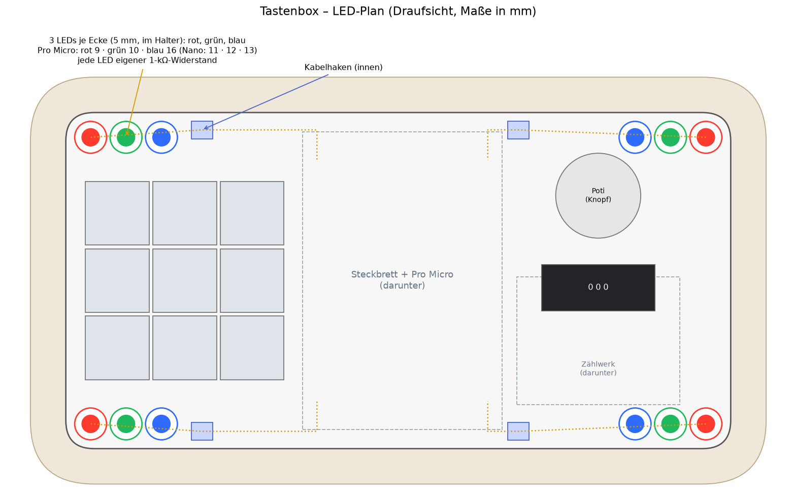
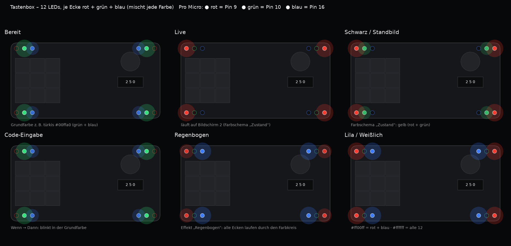

# Tastenbox – Verdrahtungsplan (nur stecken, nichts löten)

Teile: Pro Micro (USB-C) **oder Arduino Nano** · Steckbrett 400 Kontakte · 9 MX-Schalter · Drehregler 10 kΩ linear ·
Dupont-Kabel Buchse–Stecker und Stecker–Stecker · optional LED + 220-Ω-Widerstand oder LED-Streifen WS2812B.

Ausnahme: Die Stiftleisten am Pro Micro müssen einmal angelötet werden. Bis dahin hält die gedruckte
Klemme (`klemme_pro_micro.py`) die Platine auf die Stifte gedrückt.

## 0. Welcher Pin wofür (das Programm erkennt das Board selbst)

| | Pro Micro | Nano |
|---|---|---|
| Tasten 1–9 | 2, 3, 4, 5, 6, 7, 8, 14, 15 | 2, 3, 4, 5, 6, 7, 8, 9, 10 |
| Drehregler (Mitte) | A0 | A0 |
| Eck-LEDs (je 1 kΩ) | 9 | 11 |
| Lichtleiste (WS2812B, DIN) | 10 | 12 |
| Plus / Minus | VCC / GND | 5V / GND |

Hochladen: Arduino-IDE → Board „Arduino Leonardo“ (Pro Micro) bzw. „Arduino Nano“ → Programm aus AluPC
(Seite Tastenbox → „Arduino-Programm speichern …“).

## 1. Pro Micro – welcher Pin ist wo

USB-C zeigt nach oben, Bauteile zu dir:

```
              USB-C
          ┌───┴───┴───┐
   TX  1 ─┤           ├─ RAW
   RX  0 ─┤           ├─ GND  ◄── Minus-Leiste
   GND  ──┤           ├─ RST
   GND  ──┤           ├─ VCC  ◄── Plus-Leiste
  Taste1 2 ─┤         ├─ A3
  Taste2 3 ─┤         ├─ A2
  Taste3 4 ─┤         ├─ A1
  Taste4 5 ─┤         ├─ A0   ◄── Regler (Mitte)
  Taste5 6 ─┤         ├─ 15   ◄── Taste 9
  Taste6 7 ─┤         ├─ 14   ◄── Taste 8
  Taste7 8 ─┤         ├─ 16      (frei – später Zündschloss)
     LED 9 ─┤         ├─ 10   ◄── LED-Streifen DIN (optional)
          └───────────┘
```

## 2. Aufs Steckbrett

1. Pro Micro **quer über den Mittelsteg** stecken, ganz ans hintere Ende, USB-C zeigt nach hinten
   (zum Kabelfenster im Gehäuse). Jeder Pin hat dann in seiner Reihe 4 freie Löcher.
2. **GND** (rechts, 2. von oben) → Kabel zur **blauen Leiste (−)**.
3. **VCC** (rechts, 4. von oben) → Kabel zur **roten Leiste (+)**.
4. Die zweite Seite des Steckbretts (andere Längsseite) mit je einem Kabel verbinden:
   blau↔blau, rot↔rot. Dann hast du auf beiden Seiten Plus und Minus.

## 3. Tasten (9 Stück, 3 × 3)

Jeder Schalter hat 2 Beinchen. Auf jedes Beinchen eine **Dupont-Buchse** stecken.

| Taste (Lage auf der Box) | Beinchen A → Pin | Beinchen B → |
|---|---|---|
| 1 (oben links)   | 2  | blaue Leiste (−) |
| 2 (oben Mitte)   | 3  | blaue Leiste (−) |
| 3 (oben rechts)  | 4  | blaue Leiste (−) |
| 4 (Mitte links)  | 5  | blaue Leiste (−) |
| 5 (Mitte)        | 6  | blaue Leiste (−) |
| 6 (Mitte rechts) | 7  | blaue Leiste (−) |
| 7 (unten links)  | 8  | blaue Leiste (−) |
| 8 (unten Mitte)  | 14 | blaue Leiste (−) |
| 9 (unten rechts) | 15 | blaue Leiste (−) |

Egal, welches Beinchen A oder B ist. Wackelt eine Buchse: ein Tropfen Heißkleber.

**Tastenkappen (3D-Druck):** `tastenkappe.py` → `tastenkappe_1.stl` … `_9.stl` (Ziffer vertieft) und
`tastenkappe_eng/mittel/locker.stl` (leer). Passt auf Outemu/MX (Kreuz „+“). Zuerst **eine** „mittel“ drucken
und probieren: wackelt → „eng“, geht nicht drauf → „locker“. Druck: Oberseite nach unten, ohne Stützen,
0,12–0,16 mm Schicht. Vorschau: `tastenkappe_preview.png`.

## 4. Drehregler (3 Beinchen)

| Beinchen | → |
|---|---|
| links  | blaue Leiste (−) |
| Mitte  | A0 |
| rechts | rote Leiste (+) |

Dreht er falsch herum: links und rechts tauschen – oder in AluPC „Richtung umkehren“.

**Zahl 0–999 (für Wenn → Dann):** Ab Programm 5 meldet die Box den Regler zusätzlich fein als `WERT 0–999`.
Gut dafür: ein 10-Gang-Poti (10 kΩ) mit Zählwerk-Drehknopf – gleich angeschlossen wie oben.
In AluPC „Regelt:“ auf „Zahl 0–999“ stellen. Zählwerk und Messwert weichen um ein paar Schritte ab
(Poti-Toleranz, 10-Bit-Messung = 1024 Stufen) – deshalb hat jede Regel „± Toleranz“ (Standard 3).
Mit „Jetzt“ im Regel-Fenster die echte Zahl übernehmen.

**Lautstärke übers Zählwerk:** „Vorlage:“ bzw. „Skala:“ am Regler – „Zählwerk 000–999 ÷ 10“ (Zählwerk 455 = 46 %)
oder „Zählwerk 000–100 = Prozent“ (Zählwerk 073 = 73 %, ab 100 voll).

## 5. Licht – Plan



| Was | Wo | Pin | In AluPC einstellbar |
|---|---|---|---|
| 4 Eck-LEDs (5 mm) | je ein Halter innen in jeder Ecke | Pro Micro 9 / Nano 11 | an, aus, bei Live; Helligkeit; ruhig/atmen/blinken; Blitz bei Tastendruck |
| Lichtleiste vorn | Schlitz vor den Tasten, Schiene darunter | Pro Micro 10 / Nano 12 | zusätzlich die **Farbe** |

**Eck-LEDs einbauen (ca. 10 Min.):**
1. LED von innen in den Halter drücken, bis der Rand anliegt – die Kuppe ist dann bündig mit der Oberseite.
2. Beine zeigen in die Kerbe (Richtung Box-Mitte).
3. Langes Bein: 1-kΩ-Widerstand mit Dupont-Buchse aufstecken; kurzes Bein: Dupont-Buchse.
4. Kabel durch den nächsten Kabelhaken, an der Wand entlang zum Steckbrett.
5. Alle 4 Widerstände → Pin 9 (Nano 11), alle kurzen Beine → Minus-Leiste.

**Lichtleiste (optional, ca. 10 Min.):** WS2812B-Streifen, 10 mm breit, **mit fertig angelötetem Kabel** kaufen
(sonst müsste man löten). 60 LEDs/m → 3 LEDs passen, 144 LEDs/m → 7.
1. Streifen von rechts in die Schiene schieben, LEDs nach oben, Klebeseite auf den Schienenboden.
2. Kabel durch das Fenster im Schienenboden: DIN → Pin 10 (Nano 12), 5V → Plus, GND → Minus.
3. Im Arduino-Programm `// #define STREIFEN 8` → `#define STREIFEN 3` (bzw. 7), neu hochladen.

### Bunt: RGB-LEDs (jede LED eigene Farbe) – empfohlen



Statt einfarbiger LEDs: **adressierbare RGB-LEDs in einer Kette** an einem einzigen Pin. AluPC kann dann
jede LED einzeln färben – Farbschemata in AluPC (Tastenbox → Box → Farbschema, auch am Handy):
**Eine Farbe**, **Ecken bunt** (jede Ecke eigene Farbe), **Zustand** (Rot = läuft auf Bildschirm 2,
Gelb = Schwarz/Standbild, sonst Grundfarbe), **Regenbogen** (läuft in der Box selbst).

Teile (ohne Löten):
- 4 × **PL9823**, 5 mm, adressierbar (4 Beine, passen in die Eck-Halter, Dupont-Buchsen steckbar)
- Lichtleiste: WS2812B-Streifen 10 mm **mit fertig angelötetem Kabel**, 144 LEDs/m → 7 LEDs
- Dupont-Kabel Buchse–Buchse

Kette (Reihenfolge = Nummer im Bild): Pin → **0** vorne links → **1** hinten links → **2** hinten rechts →
**3** vorne rechts → Lichtleiste (ab **4**).
1. Pin 10 (Nano 12) → DIN von LED 0.
2. DOUT von LED 0 → DIN von LED 1, und so weiter bis LED 3. DOUT von LED 3 → DIN der Lichtleiste.
3. Jede LED: 5V-Bein an die Plus-Leiste, GND-Bein an die Minus-Leiste (über die Kabelhaken führen).
4. Im Arduino-Programm: `#define STREIFEN 11` (4 + 7) und `#define ECKEN_PL9823` einschalten, hochladen.

Strom: 11 LEDs bei voller Helligkeit weiß ≈ 0,6 A – am USB in AluPC die Helligkeit auf höchstens 50 % lassen.
Nicht getestet: Programm 4 läuft nur in der PC-Simulation; Farbreihenfolge der PL9823 kann je Hersteller
abweichen (falsche Farben → `ECKEN_PL9823` aus- bzw. einschalten).

Tipp: Wer das Oberteil in hellem Filament druckt, kann in `tastenbox_gehaeuse.py` `led_skin = 0.6` bzw.
`bar_skin = 0.6` setzen – dann sind die Löcher oben zu und das Licht scheint weich durch (unsichtbar, solange aus).

### Licht – technische Details

- **4 LEDs in den Ecken** (5 mm, Halter sind im Gehäuse): jede LED bekommt einen **eigenen 1-kΩ-Widerstand**
  (aus deinem Set). Pin 9 → je 1 kΩ → langes LED-Bein; kurze Beine → blaue Leiste (−).
  Alle 4 hängen zusammen an Pin 9, AluPC schaltet sie (Live/An/Aus, Helligkeit, Blitz bei Tastendruck).
  Nicht kleiner als 1 kΩ: Pin 9 verträgt höchstens ca. 40 mA, 4 LEDs mit 1 kΩ brauchen zusammen ca. 12 mA.
  (Einen 3,3-V-Pin hat der Pro Micro 5 V nicht – VCC ist 5 V.)
- **Eine LED:** Pin 9 → 220-Ω-Widerstand → langes LED-Bein. Kurzes Bein → blaue Leiste (−).
- **LED-Streifen WS2812B** (bis ca. 8–10 LEDs): DIN → Pin 10, 5V → rote Leiste (+), GND → blaue Leiste (−).
  Im Arduino-Programm die Zeile `// #define STREIFEN 8` aktivieren (die `//` löschen).

## 6. Nicht am Pro Micro

- **Fingerabdrucksensor:** bleibt an seinem eigenen USB-Adapter → USB-Kabel hinten raus zum PC.
- **Zündschloss:** vorerst nur mechanisch. Wenn es mitmelden soll: ein Kontakt → Pin 16, anderer → Minus.
  (Arduino-Programm und AluPC brauchen dafür noch eine Erweiterung – sag Bescheid.)

## 7. Fehlersuche in AluPC

Seite **Geräte → Tastenbox → Fehlersuche → Anzeigen**:
- oben: Anschluss, Programmversion, Board (Nano/Pro Micro)
- **Rohwerte live**: Taste unten → leuchtet in der App, solange sie gedrückt ist; Regler als Zahl 0–1023
- **Protokoll**: jede Zeile zwischen AluPC und Box (→ gesendet, ← empfangen), auch „keine Antwort“ bei der Suche
- **LED testen** (blitzt 3×), **Neu verbinden**, **Protokoll kopieren** (zum Schicken)

## 8. Testen ohne Bauteile: Online-Simulation (Wokwi)

1. https://wokwi.com öffnen → „Arduino Mega“ neues Projekt.
   (Einen Pro Micro gibt es dort nicht. Auf Mega/Nano nimmt das Programm die Nano-Belegung: Tasten 2–10, LEDs 11.)
2. Inhalt von `wokwi/sketch.ino` in `sketch.ino` kopieren.
3. Inhalt von `wokwi/diagram.json` in `diagram.json` kopieren (Reiter oben).
4. ▶ starten. Taste anklicken → unten im Serial Monitor erscheint `TASTE 1`, gedrückt halten → `LANG 1`,
   Regler drehen → `LAUT 57`.
