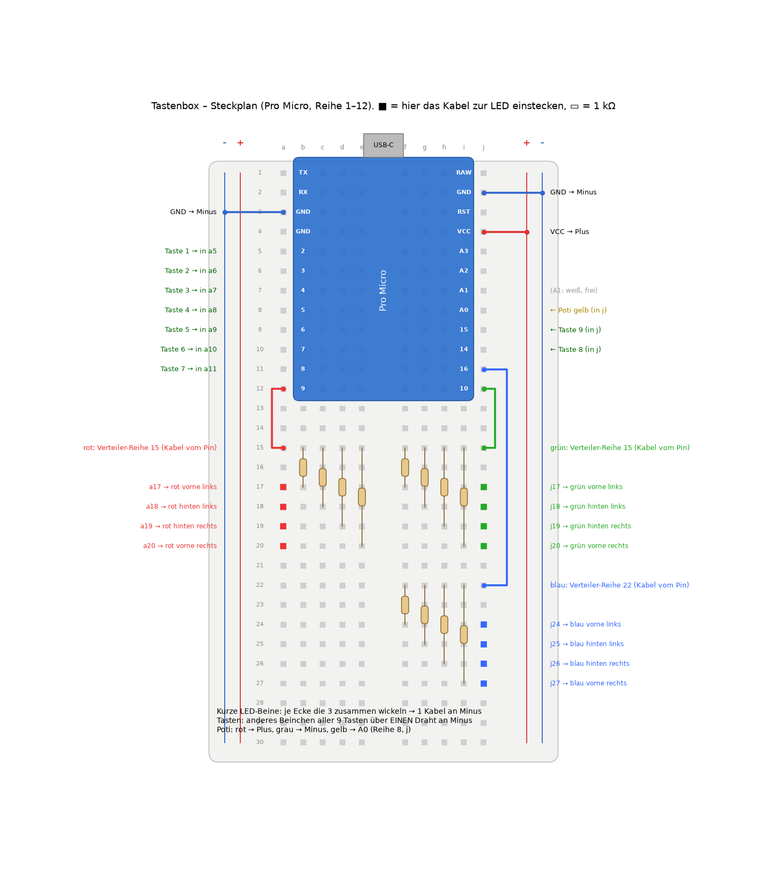

# Tastenbox – Verdrahtungsplan (nur stecken, nichts löten)

Teile: Pro Micro (USB-C) **oder Arduino Nano** · Steckbrett 400 Kontakte · 9 MX-Schalter (Outemu) ·
10-Gang-Poti mit Zählwerk · 12 LEDs 5 mm (4 × rot, 4 × grün, 4 × blau) + 12 × 1 kΩ ·
Dupont-Kabel Buchse–Stecker und Stecker–Stecker.

Ausnahme: Die Stiftleisten am Pro Micro müssen einmal angelötet werden. Bis dahin hält die gedruckte
Klemme (`klemme_pro_micro.py`) die Platine auf die Stifte gedrückt.

## 0. Welcher Pin wofür (das Programm erkennt das Board selbst)

| | Pro Micro | Nano |
|---|---|---|
| Tasten 1–9 | 2, 3, 4, 5, 6, 7, 8, 14, 15 | 2, 3, 4, 5, 6, 7, 8, 9, 10 |
| Drehregler (Mitte) | A0 | A0 |
| LEDs rot (4 Stück, je 1 kΩ) | 9 | 11 |
| LEDs grün (4 Stück, je 1 kΩ) | 10 | 12 |
| LEDs blau (4 Stück, je 1 kΩ) | 16 | 13 |
| (frei: weiß, optional) | A1 | A1 |
| Plus / Minus | VCC / GND | 5V / GND |

Hochladen: Arduino-IDE → Board „Arduino Leonardo“ (Pro Micro) bzw. „Arduino Nano“ → Programm aus AluPC
(Seite Tastenbox → „Arduino-Programm speichern …“).

## 1. Pro Micro – welcher Pin ist wo

USB-C zeigt nach oben, Bauteile zu dir:

```
              USB-C
          ┌───┴───┴───┐
   TX  1 ─┤           ├─ RAW
   RX  0 ─┤           ├─ GND  ◄── Minus-Leiste
   GND  ──┤           ├─ RST
   GND  ──┤           ├─ VCC  ◄── Plus-Leiste
  Taste1 2 ─┤         ├─ A3
  Taste2 3 ─┤         ├─ A2
  Taste3 4 ─┤         ├─ A1   ◄── LEDs weiß
  Taste4 5 ─┤         ├─ A0   ◄── Regler (Mitte)
  Taste5 6 ─┤         ├─ 15   ◄── Taste 9
  Taste6 7 ─┤         ├─ 14   ◄── Taste 8
  Taste7 8 ─┤         ├─ 16   ◄── LEDs blau
 LEDs rot 9 ─┤        ├─ 10   ◄── LEDs grün
          └───────────┘
```

## 2. Aufs Steckbrett

1. Pro Micro **quer über den Mittelsteg** stecken, ganz ans hintere Ende, USB-C zeigt nach hinten
   (zum Kabelfenster im Gehäuse). Jeder Pin hat dann in seiner Reihe 4 freie Löcher.
2. **GND** (rechts, 2. von oben) → Kabel zur **blauen Leiste (−)**.
3. **VCC** (rechts, 4. von oben) → Kabel zur **roten Leiste (+)**.
4. Die zweite Seite des Steckbretts (andere Längsseite) mit je einem Kabel verbinden:
   blau↔blau, rot↔rot. Dann hast du auf beiden Seiten Plus und Minus.

## 3. Tasten (9 Stück, 3 × 3)

Jeder Schalter hat 2 Beinchen. Auf jedes Beinchen eine **Dupont-Buchse** stecken.

**Beinchen zu dünn, Dupont-Buchse wackelt?** Ohne Löten, in dieser Reihenfolge:
1. **Wickeln (Wire-Wrap):** Litze/Draht 0,14–0,25 mm² 15 mm abisolieren, 4–5 Windungen fest um das Beinchen,
   Schrumpfschlauch oder Isoband drüber. Hält dauerhaft, das andere Ende hat einen Dupont-Stecker fürs Steckbrett.
2. **Minus als ein Draht:** alle 9 „B“-Beinchen nacheinander mit EINEM blanken Draht umwickeln (Masse-Schiene) →
   nur 10 statt 18 Verbindungen, ein Ende in die blaue Leiste.
3. **Buchse enger machen:** Dupont-Buchse mit einer Spitzzange leicht zusammendrücken – klemmt dann auf dem flachen
   Beinchen (schnell, kann sich mit der Zeit lockern).
4. Notlösung zum Testen: Mini-Abgreifklemmen (Prüfklemmen) – passen, sind aber groß.

| Taste (Lage auf der Box) | Beinchen A → Pin | Beinchen B → |
|---|---|---|
| 1 (oben links)   | 2  | blaue Leiste (−) |
| 2 (oben Mitte)   | 3  | blaue Leiste (−) |
| 3 (oben rechts)  | 4  | blaue Leiste (−) |
| 4 (Mitte links)  | 5  | blaue Leiste (−) |
| 5 (Mitte)        | 6  | blaue Leiste (−) |
| 6 (Mitte rechts) | 7  | blaue Leiste (−) |
| 7 (unten links)  | 8  | blaue Leiste (−) |
| 8 (unten Mitte)  | 14 | blaue Leiste (−) |
| 9 (unten rechts) | 15 | blaue Leiste (−) |

Egal, welches Beinchen A oder B ist. Wackelt eine Buchse: ein Tropfen Heißkleber.

**Tastenkappen (3D-Druck):** `tastenkappe.py` → `tastenkappe_1.stl` … `_9.stl` (Ziffer vertieft) und
`tastenkappe_eng/passend/mittel/locker.stl` (leer). Passt auf Outemu/MX (Kreuz „+“). Standard: „passend“ (zwischen eng und mittel). Zum Nachjustieren: „mittel“
und probieren: wackelt → „eng“, geht nicht drauf → „locker“. Druck: Oberseite nach unten, ohne Stützen,
0,12–0,16 mm Schicht. Vorschau: `tastenkappe_preview.png`.

## 4. Drehregler (3 Beinchen)

| Beinchen | → |
|---|---|
| links  | blaue Leiste (−) |
| Mitte  | A0 |
| rechts | rote Leiste (+) |

Dreht er falsch herum: links und rechts tauschen – oder in AluPC „Richtung umkehren“.

**Dein 10-Gang-Poti (DDR, 490.02xx) mit den 3 Drähten:** Vermutung – bitte mit dem Messgerät (Ω) prüfen:
rot und grau (seitliche Fahnen) = die Enden, **gelb (hinten, Mitte der Achse) = Schleifer → A0**.
Prüfen: rot↔grau = immer gleich (z. B. 10 kΩ); gelb↔rot ändert sich beim Drehen. Dann rot → rote Leiste (+),
grau → blaue Leiste (−), gelb → A0. Jeder Wert von 1 kΩ bis 100 kΩ geht; 10 kΩ ist ideal.

**Einbau (tastenbox_gehaeuse.py, Entwurf 4):** Poti steht senkrecht, Gewindehals von unten durch das Loch im
Deckel, oben Zahnscheibe + Mutter, darauf `drehknopf.stl` (M3-Madenschraube seitlich). Das **Zählwerk** hängt an
4 Säulen unter dem Deckel: M3-Schrauben von unten durch seine Langlöcher in die Säulen; die Ziffernzeile liegt
unter dem Fenster. Schnitt: `tastenbox_schnitt.png`. Die Maße von Poti und Zählwerk sind aus Fotos geschätzt –
Werte mit „NACHMESSEN“ im Skript prüfen (v. a. Gewindehals-Ø, Höhe des Zählwerks, Lage der Langlöcher).
Zählwerk und Poti sind **nicht** miteinander verbunden (Zahnräder fehlen) – siehe offene Frage im Chat.

**Zahl 0–999 (für Wenn → Dann):** Ab Programm 5 meldet die Box den Regler zusätzlich fein als `WERT 0–999`.
Gut dafür: ein 10-Gang-Poti (10 kΩ) mit Zählwerk-Drehknopf – gleich angeschlossen wie oben.
In AluPC „Regelt:“ auf „Zahl 0–999“ stellen. Zählwerk und Messwert weichen um ein paar Schritte ab
(Poti-Toleranz, 10-Bit-Messung = 1024 Stufen) – deshalb hat jede Regel „± Toleranz“ (Standard 3).
Mit „Jetzt“ im Regel-Fenster die echte Zahl übernehmen.

**Lautstärke übers Zählwerk:** „Vorlage:“ bzw. „Skala:“ am Regler – „Zählwerk 000–999 ÷ 10“ (Zählwerk 455 = 46 %)
oder „Zählwerk 000–100 = Prozent“ (Zählwerk 073 = 73 %, ab 100 voll).

## 5. Licht – Plan


**Konzept „Farbmischer“:** 12 einfarbige 5-mm-LEDs, **3 pro Ecke in einer Reihe: rot (außen), grün, blau (innen)**.
Jede Ecke mischt wie eine RGB-LED – AluPC kann damit jede Farbe zeigen (gelb = rot + grün, lila = rot + blau,
türkis = grün + blau, alle drei ≈ weiß). Die 4 roten hängen an einem Pin, die 4 grünen an einem, die 4 blauen an einem.


| Zustand | was leuchtet | in AluPC |
|---|---|---|
| Bereit | Grundfarbe in allen Ecken | Farbe wählen (z. B. türkis) |
| Live (läuft auf Bildschirm 2) | rot | Farbschema „Zustand“ |
| Schwarz / Standbild | gelb | Farbschema „Zustand“ |
| Code-Eingabe (Wenn → Dann) | blinkt | automatisch |
| Regenbogen | alle Ecken laufen durch den Farbkreis | Effekt „Farbwechsel / Regenbogen“ |

Helligkeit, Atmen, Blinken und der Blitz bei Tastendruck gehen wie bisher (Arduino-Programm 6, `#define VIER_FARBEN`
ist an). Weiße LEDs: nicht in den Ecken nötig – Pin A1 bleibt frei (z. B. später als Licht fürs Zählwerk).

### Steckplan (Pro Micro auf dem Steckbrett, Reihe 1–12)



„a“ = das freie Loch links außen neben dem Pin, „j“ = rechts außen (je nachdem, wo dein Pro Micro steckt,
kann das auch b oder i sein – Hauptsache dieselbe **Reihe** wie der Pin).

1. **Strom:** GND (Reihe 2 rechts) → blaue Minus-Leiste rechts; GND (Reihe 3 links) → Minus-Leiste links;
   VCC (Reihe 4 rechts) → rote Plus-Leiste rechts. (Prüfen, ob die Leisten in der Mitte getrennt sind – dann brücken.)
2. **Tasten:** Taste 1–7 in a5–a11 (Pins 2–8), Taste 8 in j10 (Pin 14), Taste 9 in j9 (Pin 15).
   Das andere Beinchen aller 9 Tasten über **einen** gewickelten Draht an Minus.
3. **Poti:** gelb → j8 (A0), rot → Plus, grau → Minus.
4. **LEDs, je Farbe gleich:** Kabel vom Farb-Pin in eine freie **Verteiler-Reihe** (rot: a12 → a15,
   grün: j12 → j15, blau: j11 → j22). Von der Verteiler-Reihe 4 Widerstände (1 kΩ) in 4 **eigene** Reihen
   (je Widerstand eine andere Reihe!). Dort das Kabel zum langen Bein der LED in der jeweiligen Ecke.
5. **Kurze LED-Beine:** je Ecke die 3 zusammenwickeln → 1 Kabel an Minus (4 Kabel für alle 12 LEDs).

**LEDs einbauen (ca. 25 Min.):**
1. LED von innen in ihren Halter drücken, bis der Rand anliegt – die Kuppe ist dann bündig mit der Oberseite.
   Reihenfolge je Ecke: außen rot, Mitte grün, innen blau.
2. Beine zeigen in die Kerbe (Richtung Box-Mitte).
3. Langes Bein (+) → Kabel zum Steckbrett (Reihe laut Steckplan), kurzes Bein (−) → Minus.
4. Kabel über den nächsten Kabelhaken an der Wand entlang zum Steckbrett.

Strom: jede LED ~3 mA, 4 an einem Pin ~12 mA (erlaubt: 40 mA), alle 12 zusammen ~36 mA – passt locker an USB.
Kleiner als 1 kΩ nicht nötig. (Nano: D13 hat eine eigene kleine LED – die leuchtet mit Blau mit, das ist normal.)

Tipp: Wer das Oberteil in hellem Filament druckt, kann in `tastenbox_gehaeuse.py` `led_skin = 0.6` setzen –
dann sind die Löcher oben zu und das Licht scheint weich durch (unsichtbar, solange aus).

Nicht getestet: Programm 6 lief nur in der PC-Simulation (Farben → Pins, Regenbogen, Helligkeit stimmen dort,
für Nano und Pro Micro). Es braucht einen Pro Micro mit 16 MHz (USB-C-Nachbauten meist 5 V / 16 MHz).

### Andere LEDs (alte Varianten)

- **Weiße LEDs als 4. Farbe in den Ecken** (Konzept „Kreuz“): `#define WEISS_IN_ECKEN` einschalten, weiß an A1.
- **Alle LEDs an einem Pin** (nur an/aus/Helligkeit): im Programm `#define VIER_FARBEN` ausschalten (`//` davor),
  alle Widerstände an D11 (Pro Micro D9).
- **RGB-LEDs/Streifen (WS2812B, PL9823):** `VIER_FARBEN` aus, `#define STREIFEN n` an, DIN an D12 (Pro Micro D10).

## 6. Fehlersuche in AluPC

Seite **Geräte → Tastenbox → Fehlersuche → Anzeigen**:
- oben: Anschluss, Programmversion, Board (Nano/Pro Micro)
- **Rohwerte live**: Taste unten → leuchtet in der App, solange sie gedrückt ist; Regler als Zahl 0–1023
- **Protokoll**: jede Zeile zwischen AluPC und Box (→ gesendet, ← empfangen), auch „keine Antwort“ bei der Suche
- **LED testen** (blitzt 3×), **Neu verbinden**, **Protokoll kopieren** (zum Schicken)

## 7. Testen ohne Bauteile: Online-Simulation (Wokwi)

1. https://wokwi.com öffnen → „Arduino Mega“ neues Projekt.
   (Einen Pro Micro gibt es dort nicht. Auf Mega/Nano nimmt das Programm die Nano-Belegung: Tasten 2–10, LEDs 11.)
2. Inhalt von `wokwi/sketch.ino` in `sketch.ino` kopieren.
3. Inhalt von `wokwi/diagram.json` in `diagram.json` kopieren (Reiter oben).
4. ▶ starten. Taste anklicken → unten im Serial Monitor erscheint `TASTE 1`, gedrückt halten → `LANG 1`,
   Regler drehen → `LAUT 57`.
